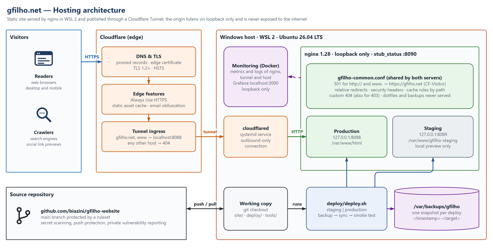
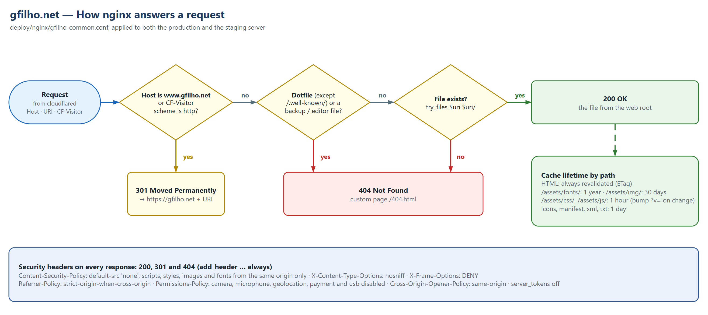
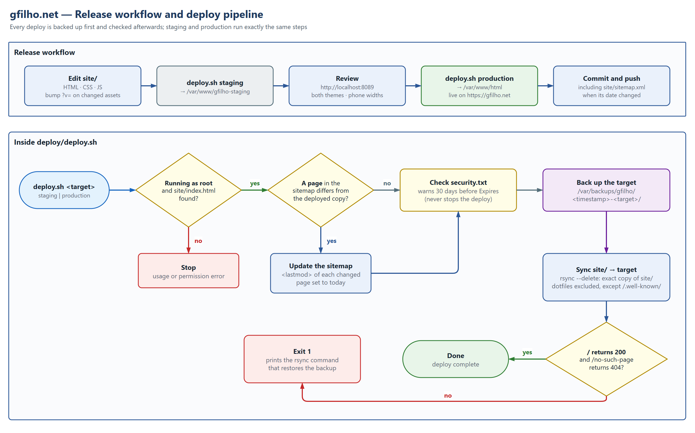

<p align="center"></p>

<h1 align="center">gfilho.net</h1>

<p align="center">Source of <a href="https://gfilho.net/">gfilho.net</a>, the personal site of Guilherme Filho:<br>platform and infrastructure engineer working on hybrid cloud and automation.</p>

A static, single-page site: plain HTML, CSS and two small JavaScript files. No framework, no build step, no analytics, no cookies set by the site and no third-party requests at runtime. It is served by nginx inside WSL 2 and published through a Cloudflare Tunnel, so the origin is never exposed to the internet.

| | |
|---|---|
| **Live site** | <https://gfilho.net/> |
| **Stack** | HTML5, CSS, vanilla JavaScript · nginx 1.28 (WSL 2, Ubuntu 26.04 LTS) · Cloudflare Tunnel |
| **Security** | Strict same-origin CSP, security headers on every response, loopback-only origin, HTTPS-only canonical host, [security.txt](https://gfilho.net/.well-known/security.txt) |
| **Quality** | W3C-valid HTML and CSS · WCAG 2.2 AA · Lighthouse 100 for accessibility, best practices and SEO |

<p align="center"></p>

## Contents

1. [Features](#1-features)
2. [Architecture](#2-architecture)
3. [Request handling](#3-request-handling)
4. [Repository layout](#4-repository-layout)
5. [Working on the site](#5-working-on-the-site)
6. [Design notes](#6-design-notes)
7. [Images and diagrams](#7-images-and-diagrams)
8. [Checking a release](#8-checking-a-release)
9. [Monitoring](#9-monitoring)
10. [Security](#10-security)
11. [Licenses](#11-licenses)

---

## 1. Features

- **One page, five sections:** About, Toolbox, Projects, Articles and Links, with a header navigation that highlights the section in view.
- **Case studies:** each project links to a dedicated page under `/cases/` written in the STAR format (Situation, Task, Action, Result), with the measured results first. Every page has its own URL, so it can be shared directly.
- **Light and dark themes:** the page follows the operating system; the header button overrides it and remembers the choice. The theme is applied before the first paint, so there is no flash.
- **Accessible:** semantic landmarks, a skip link, visible focus, tap targets of at least 24 px and colour contrast that meets WCAG 2.2 AA in both themes.
- **Fast:** self-hosted, subset fonts; no render-blocking third-party code; long cache lifetimes for files whose names never change.
- **Search and sharing:** Open Graph and Twitter card metadata, JSON-LD `Person` data, `sitemap.xml`, `robots.txt` and a web app manifest.
- **Private by design:** nothing is loaded from other domains, and nothing is stored about visitors (the only `localStorage` entry is the visitor's own theme choice).

## 2. Architecture



*Figure 1. Hosting architecture (source: [`gfilho-hosting-architecture.drawio`](docs/architecture/gfilho-hosting-architecture.drawio))*

Visitors reach Cloudflare over HTTPS. Cloudflare terminates TLS and forwards the request through a named tunnel to `cloudflared`, which runs as a systemd service inside WSL and keeps an **outbound-only** connection to Cloudflare. `cloudflared` passes the request to nginx on `localhost:8088`. nginx listens on loopback only, so the origin cannot be reached from the network, even from the local LAN.

| Component | Where | Responsibility |
|---|---|---|
| Cloudflare edge | Cloudflare | DNS (proxied records), edge certificate, TLS 1.2+, HSTS, Always Use HTTPS, static asset cache, email obfuscation. |
| Tunnel ingress | Cloudflare | Routes `gfilho.net` and `www.gfilho.net` to `http://localhost:8088`; every other host name gets a 404. |
| `cloudflared` | WSL, systemd | Holds the tunnel open. No inbound port is needed on the host or the router. |
| nginx, production | `127.0.0.1:8088` | Serves `/var/www/html`, the live site. |
| nginx, staging | `127.0.0.1:8089` | Serves `/var/www/gfilho-staging` for local previews; never published. |
| nginx, status | `127.0.0.1:8090` | `stub_status` counters for the monitoring stack; loopback only. |
| `deploy/deploy.sh` | WSL | Publishes `site/` to staging or production, with a backup and a smoke test. |
| Backups | `/var/backups/gfilho` | One snapshot of the target per deploy (and of the nginx configuration per install), readable by root only. |
| Monitoring | WSL, Docker, loopback ports | Prometheus, Loki, Alloy, exporters and Grafana on `http://localhost:3000` ([9. Monitoring](#9-monitoring)). |
| Source repository | GitHub | `main` is protected by a ruleset (no deletion, no force push); secret scanning, push protection and private vulnerability reporting are on. |

## 3. Request handling



*Figure 2. Request handling in nginx (source: [`gfilho-request-handling.drawio`](docs/architecture/gfilho-request-handling.drawio))*

Both server blocks include the same snippet, [`deploy/nginx/gfilho-common.conf`](deploy/nginx/gfilho-common.conf), so staging behaves exactly like production:

1. **Canonical host.** Requests for `www.gfilho.net`, or requests that reached Cloudflare over plain HTTP (the `CF-Visitor` header carries `"scheme":"http"`), get a `301` to `https://gfilho.net` with the same path.
2. **Hidden files.** Dotfiles (except `/.well-known/`), editor leftovers and backup files (`.bak`, `.old`, `.orig`, `.swp`, `~` and similar) always return `404`, even if one ends up in the web root by mistake.
3. **Directories.** A directory without the trailing slash (`/cases/self-healing`) gets a **relative** `301` to `/cases/self-healing/` (`absolute_redirect off`, so nginx never sends its internal `:8088` port). `/cases/` itself redirects to `/#projects`, and any other directory without an `index.html` (`/assets/`, `/.well-known/`) gets the 404 page instead of nginx's default 403.
4. **Static files.** Anything else is served from the web root with `try_files`; a missing file gets the custom `/404.html` page with a real `404` status.

Security headers are set at server level with `always`, so they are sent on every response, including redirects and errors:

| Header | Value | Purpose |
|---|---|---|
| `Content-Security-Policy` | `default-src 'none'`; scripts, styles, images, fonts, manifest and connections from `'self'` only; `base-uri 'none'`; `form-action 'none'`; `frame-ancestors 'none'` | Only the site's own files can load or run; no inline code. |
| `X-Content-Type-Options` | `nosniff` | Browsers trust the declared content type. |
| `X-Frame-Options` | `DENY` | The page cannot be framed (with `frame-ancestors` for modern browsers). |
| `Referrer-Policy` | `strict-origin-when-cross-origin` | Other sites see only the origin, never the full URL. |
| `Permissions-Policy` | `camera=(), microphone=(), geolocation=(), payment=(), usb=()` | Powerful browser features are switched off. |
| `Cross-Origin-Opener-Policy` | `same-origin` | Isolates the page from windows opened by other sites. |

HSTS is set by Cloudflare at the edge, and `server_tokens off` hides the nginx version.

Cache lifetimes depend on the path:

| Path | Lifetime | Why |
|---|---|---|
| HTML (`/`, `/404.html`) | revalidated on every visit (ETag) | Content changes show up immediately. |
| `/assets/fonts/` | 1 year | Font files are never changed in place. |
| `/assets/img/` | 30 days | Photos and app icons rarely change. |
| `/assets/css/`, `/assets/js/` | 1 hour | Bump `?v=` on the page when they change (see [conventions](#55-conventions)). |
| Icons, manifest, `.xml`, `.txt` | 1 day | Favicons, `sitemap.xml`, `robots.txt`, `security.txt`. |

## 4. Repository layout

```text
.
├── site/                        What gets published (the web root)
│   ├── index.html               The page
│   ├── 404.html                 Not-found page
│   ├── cases/<slug>/index.html  Project case studies (STAR), linked from the project cards
│   ├── assets/css/main.css      All styles (design tokens for both themes at the top)
│   ├── assets/js/theme.js       Applies the saved light/dark choice before the first paint
│   ├── assets/js/main.js        Theme switch, footer year, section highlight, "Latest project" pulse
│   ├── assets/fonts/            Newsreader and Hanken Grotesk (latin subset) and their licences
│   ├── assets/img/              Profile photo and app icons
│   ├── .well-known/security.txt Security contact (RFC 9116)
│   └── favicon.svg / .ico, apple-touch-icon.png, og-image.png,
│       site.webmanifest, robots.txt, sitemap.xml
├── deploy/
│   ├── deploy.sh                Publish site/ to staging or production (backup, sync, smoke test)
│   ├── install-nginx.sh         Install the nginx configuration (rolls back if `nginx -t` fails)
│   ├── nginx/                   Server blocks, security headers, cache rules, redirects, stub_status
│   └── systemd/                 nginx drop-in: restart automatically if it dies
├── monitoring/                  Prometheus, Loki, Alloy, exporters and Grafana (Docker Compose)
│   ├── install-monitoring.sh    Install or update the stack and reload what changed (run as root in WSL)
│   ├── grafana/build-dashboard.mjs  Source of the three dashboards; writes grafana/dashboards/*.json
│   ├── prometheus/rules.test.yml    promtool unit tests for the alert rules and dashboard expressions
│   └── tests/                   check-queries.py, check-values.py, query-timings.py: validate the dashboards
├── docs/architecture/           Diagrams: draw.io sources and PNG exports
├── tools/
│   ├── build-images.ps1         Regenerate og-image.png, the icons and favicon.ico with headless Chrome
│   └── og-image.html, icon.html, logo-full-bleed.svg
├── .github/                     Security policy, contributing notes, code of conduct, templates
└── LICENSE                      MIT License (code and configuration)
```

## 5. Working on the site

### 5.1 Prerequisites

| Requirement | Used for |
|---|---|
| WSL 2 with Ubuntu 26.04 LTS, nginx, `rsync` and `curl` | Serving and deploying the site (run the scripts as root). The WSL distribution is still called `Ubuntu-24.04`: it was upgraded in place. |
| Docker Engine with the Compose plugin (inside WSL) | The local monitoring stack ([9. Monitoring](#9-monitoring)). Not needed to serve the site. |
| `cloudflared` with a named tunnel whose ingress points at `http://localhost:8088` | Publishing production. Not needed to work on staging. |
| Google Chrome on Windows | Regenerating images (`tools/build-images.ps1`). |
| A code editor; optionally VS Code with the Draw.io Integration extension (`hediet.vscode-drawio`) | Editing the page and the diagrams. |

### 5.2 Release workflow



*Figure 3. Release workflow and deploy pipeline (source: [`gfilho-deploy-pipeline.drawio`](docs/architecture/gfilho-deploy-pipeline.drawio))*

Edit the files under `site/`, preview them on staging, then publish. From WSL, as root, in the repository folder:

```bash
# one-time, and again after changing deploy/nginx/*
bash deploy/install-nginx.sh

# preview at http://localhost:8089/
bash deploy/deploy.sh staging

# publish to https://gfilho.net/
bash deploy/deploy.sh production
```

`install-nginx.sh` backs up the current nginx configuration first and restores it automatically if `nginx -t` fails. It also installs a systemd drop-in (`deploy/systemd/nginx-restart.conf`) so that nginx restarts by itself if it ever dies; the stock Ubuntu unit has no restart policy. If the listen addresses changed, it restarts nginx instead of reloading it, because a reload cannot move an existing socket from `0.0.0.0` to loopback.

### 5.3 What `deploy.sh` does

1. Checks that it runs as root and that `site/index.html` exists.
2. For every page listed in `site/sitemap.xml` whose HTML differs from the deployed copy, sets that page’s `<lastmod>` to today. Commit the file together with the page.
3. Reads `Expires:` in `site/.well-known/security.txt` and prints a warning, with a renewal date one year ahead, from 30 days before it expires. The deploy carries on either way.
4. Copies the current target to `/var/backups/gfilho/<timestamp>-<target>/`.
5. Makes the target an exact copy of `site/` with `rsync --delete --delete-excluded`. Dotfiles and backup files are never published, except `/.well-known/`.
6. Checks that `/` returns `200` and `/no-such-page` returns `404`. If not, it exits with an error and prints the command that restores the backup.

### 5.4 Rolling back

Every deploy leaves a snapshot. To put one back:

```bash
ls /var/backups/gfilho/
rsync -a --delete /var/backups/gfilho/<snapshot>/ /var/www/html/
```

Snapshots ending in `-nginx` hold the nginx configuration (`sites-available`, `sites-enabled`, `snippets` and the systemd drop-in) from before an `install-nginx.sh` run.

### 5.5 Conventions

- **Articles and projects:** the newest goes first. The featured project keeps `id="latest-project"`, which the "Latest project" link points to.
- **Case studies:** copy an existing `site/cases/<slug>/index.html`, keep the four STAR sections and the results strip, and use only measured, published numbers (say where they were measured). Add a "Read the case study" button to the project card, a `<url>` to `sitemap.xml`, and point the "Next case study" links of the other pages at it. The page includes only the icons it uses in its own sprite.
- **Cache busting:** CSS and JS are cached for an hour. After changing them, bump `?v=` in the `<link>` and `<script>` tags of `index.html`, `404.html` and every page under `site/cases/`.
- **Sitemap:** `deploy.sh` keeps `<lastmod>` up to date (see [5.3](#53-what-deploysh-does)); commit the updated `sitemap.xml` together with the page.
- **security.txt:** `site/.well-known/security.txt` ([RFC 9116](https://www.rfc-editor.org/rfc/rfc9116)) expires on 2027-10-18. Update the `Expires:` line by hand when `deploy.sh` warns, and deploy again.
- **CSP:** the policy only allows same-origin resources. Inline `<script>` blocks and `style=""` attributes are blocked, so keep styles in `main.css` and code in `main.js`. `theme.js` is the one script loaded before the stylesheet; the JSON-LD block is data, not script, and is not affected.
- **Footer year:** set by `main.js` from the visitor's clock; the year written in the HTML is only a fallback for clients without JavaScript.

## 6. Design notes

- **Themes:** the dark and light colour tokens live at the top of `main.css`, and both blocks must stay in sync. Without a saved choice the page follows the OS (`prefers-color-scheme`); the header button saves the visitor's choice in `localStorage`, and `theme.js` applies it before the stylesheet loads. The two `theme-color` meta tags (`#10172A` dark, `#E8EDF4` light) are updated by `main.js` when the theme changes.
- **Typography:** Newsreader (serif) for headings and reading text, Hanken Grotesk for the interface; both self-hosted as latin-subset WOFF2 files.
- **Logo:** three isometric slabs on a midnight-blue tile (see [7. Images and diagrams](#7-images-and-diagrams)).
- **Mobile header:** below 430 px the brand block is set slightly smaller, so "Automation • Infrastructure" stays on one line next to the theme and Contact buttons (from 360 px up).
- **Mobile footer:** below 720 px the footer is a compact three-row grid: brand and ©, then the section links in one row, then location and email. The "On this page" label stays in the markup for screen readers but is visually hidden there, since the header shows the same sections.

## 7. Images and diagrams

**Logo.** The source is `site/favicon.svg`. The same artwork is inlined as the `#logo` symbol at the top of `index.html` (used in the header and footer), so keep the two in sync. `tools/logo-full-bleed.svg` is the edge-to-edge variant used for `apple-touch-icon.png`, because iOS rounds the corners itself.

**Generated images.** `og-image.png` (the 1200×630 social preview), the PNG icons and `favicon.ico` are generated from `tools/*.html`. On Windows with Google Chrome installed:

```powershell
powershell -ExecutionPolicy Bypass -File tools\build-images.ps1
```

After regenerating, bump `?v=` on the icon, manifest and `og:image` URLs in `index.html` and `404.html` (and on the icons in `site.webmanifest`), so browsers and link previews fetch the new files.

**Diagrams.** The figures in this README are drawn in [draw.io](https://www.drawio.com/). The `.drawio` files in `docs/architecture/` are the sources; open them in draw.io or in VS Code with the Draw.io Integration extension. After editing, export a PNG next to the source with the same name (*File › Export as › PNG*, zoom 200 %, border 16, white background) and commit both. When the nginx configuration or `deploy.sh` changes, update the matching diagram in the same commit.

## 8. Checking a release

Quick checks after a production deploy, from any machine:

```bash
# canonical host and redirects: expect 200, then 301 to https://gfilho.net/ twice
curl -sI https://gfilho.net/ | head -n 1
curl -sI http://gfilho.net/ | grep -iE '^(HTTP|location)'
curl -sI https://www.gfilho.net/ | grep -iE '^(HTTP|location)'

# security headers
curl -sI https://gfilho.net/ | grep -iE 'content-security-policy|x-content-type|x-frame|referrer-policy|permissions-policy|cross-origin-opener|strict-transport'

# directory without the trailing slash: expect a relative Location, /cases/self-healing/
curl -sI https://gfilho.net/cases/self-healing | grep -i '^location'

# custom 404 and blocked files: expect 404 for both
curl -s -o /dev/null -w '%{http_code}\n' https://gfilho.net/no-such-page
curl -s -o /dev/null -w '%{http_code}\n' https://gfilho.net/.git/config
```

For a full audit, run [Lighthouse](https://developer.chrome.com/docs/lighthouse) (Chrome DevTools › Lighthouse, or `npx lighthouse https://gfilho.net/`), and validate the page with the [W3C HTML](https://validator.w3.org/nu/?doc=https%3A%2F%2Fgfilho.net%2F) and [CSS](https://jigsaw.w3.org/css-validator/validator?uri=https%3A%2F%2Fgfilho.net%2F) validators.

## 9. Monitoring

A local stack watches the site, the tunnel and the WSL host, and shows it on three Grafana dashboards. Grafana opens at **<http://localhost:3000>** on this PC, read-only and without a login. The admin password is generated on the first install and is stored only in `/etc/gfilho-monitoring/grafana.env` (`sudo cat` it in WSL).

```bash
# install or update: copies monitoring/ to /opt/gfilho-monitoring, starts the containers and
# reloads Prometheus, blackbox-exporter, Alloy, Loki or Grafana when their files changed
bash monitoring/install-monitoring.sh
```

| Component | Port (loopback) | What it collects |
|---|---|---|
| Prometheus | 9091 | Metrics, 30 days; alert rules in `monitoring/prometheus/rules.yml` |
| blackbox-exporter | 9115 | Probes of the public pages (every 60 s), the origin and staging, the 301 redirects and DNS |
| nginx-prometheus-exporter | 9113 | Connections and requests from nginx `stub_status` (`127.0.0.1:8090`) |
| node-exporter | 9100 | CPU, memory, pressure (PSI), disk (the WSL disk and the Windows drive C: that holds it), network, systemd units, and the custom `gfilho_*` metrics |
| `gfilho-metrics.timer` | — | Every 2 min: security.txt expiry, last deploy, backups, WSL offline time, pending updates, component versions |
| `cloudflared` | 20241 | Tunnel connections, requests, errors and QUIC latency (built into cloudflared) |
| Loki + Alloy | 3100 | nginx access and error logs, and the journal of nginx, cloudflared and logrotate; 14 days |
| Grafana | 3000 | The three dashboards below, in the `gfilho.net` folder |

The dashboards are provisioned from files and read-only in Grafana; links at the top of each one lead to the others (keeping the time range), to the alert rules and to this section.

| Dashboard (uid) | Refresh | Question it answers | What it shows |
|---|---|---|---|
| **Overview** (`gfilho-overview`, the home page) | 1 min | Is the site reachable, fast and healthy right now? | Status strip (public site, origin, tunnel links, response time, p95, availability, monitored share of the range, alerts firing) · lifecycle strip (TLS and security.txt expiry, last deploy, WSL offline 24 h and 7 d) · one uptime line per check · alerts now and alert history (pending and firing) · public response time (log scale) · traffic through the tunnel by status class with proxy errors |
| **Analytics & Security** (`gfilho-analytics`) | 5 min | Who uses the site, what fails, what probes it? | Visitor totals (page views, requests, data served, 404, 5xx, 5xx share, log pipeline) · request sources (visitors, probes, tools, local previews, staging, against the nginx total) · responses by status class · error share · data served · top pages, 404s and referrers · clients · status mix · unusual requests · logs (collapsed) |
| **Infrastructure & Tunnel** (`gfilho-infra`) | 1 min | Where is the problem? | Services now and their history · tunnel state, data centres, responses by code, edge link · nginx vs tunnel request rate, nginx connections, probe phases · CPU & memory, memory, pressure (PSI), disk space (WSL disk and C:), network · publishing & backups, monitoring pipeline, maintenance, versions · logs (collapsed) |

How to read them:

- **States.** `UP`/`DOWN` come from the probes; `UNKNOWN` means Prometheus cannot reach the probe exporter, and `NO DATA` (grey) means there is no sample at all. A missing value is never shown as zero or as healthy.
- **Availability** counts only the time monitoring was running; **Monitored** says how much of the selected range that was. Both are needed: with WSL off there are no probes at all.
- **p95** is the 95th percentile of the probe samples (one a minute, from this PC through Cloudflare), not the latency of real visitors. nginx records `request_time` for real requests, but it is 0 ms for 99 % of them (static files), so it is not charted.
- **Latency colours** follow the web.dev TTFB guidance: good up to 0.8 s, poor above 1.8 s. The probe time includes DNS, connect, TLS and the whole response, so it is never faster than TTFB.
- **Request rates** are in requests per hour everywhere, so the nginx, tunnel and log figures compare directly.
- **Visitors** are the lines of the production access log without the monitoring probes (User-Agent `gfilho-monitor`), automated tools (curl, scripts, headless browsers, the self-audit link checker) and local previews. A page view is a visitor request to `/` or `/cases/*/` answered `200` (or `304` from the browser cache). **Clients** splits page views by User-Agent into Bots & tools, Browsers and Unclassified (exclusive groups; a scanner can pretend to be a browser, so Browsers is an upper bound for people). The logs do not record visitor IP addresses, so there are no "unique visitor" figures.
- **Annotations:** deploys (all dashboards), WSL starts (the 10 minutes after each boot) and tunnel (re)registrations (Infrastructure).

**Alerts.** `monitoring/prometheus/rules.yml` has 16 rules. Besides the site, tunnel and host rules, `ScrapeTargetDown` and `CustomMetricsStale` fire when the data an alert depends on stops arriving (a rule such as `SiteDown` cannot fire without probe results), and `HostDriveAlmostFull` watches C:, the real limit of the WSL virtual disk. There is no Alertmanager: the Overview's alert list is the notification.

**Changing the dashboards.** Edit `monitoring/grafana/build-dashboard.mjs`, regenerate the JSON with `node monitoring/grafana/build-dashboard.mjs monitoring/grafana/dashboards` (the build stops on overlapping panels, duplicate titles or ids, unknown panel types and localhost links), and run the installer again. Then check them inside WSL, with the stack running:

```bash
# alert rules and the trickier dashboard expressions, against synthetic data
docker exec gfilho-monitoring-prometheus-1 promtool test rules /etc/prometheus/rules.test.yml
# every query of every dashboard runs through Grafana for 1 h, 24 h and 7 d without errors
python3 monitoring/tests/check-queries.py
# the values match independent sources (access logs, Prometheus and cloudflared APIs, openssl, systemctl, /proc, df, journal)
sudo python3 monitoring/tests/check-values.py
# how long each query takes and how much log data it reads (write a JSON to compare before/after)
python3 monitoring/tests/query-timings.py /tmp/timings.json
```

**When the PC is off.** The stack runs inside the same WSL as the site, so it can only show that the site was down **after** WSL comes back (the uptime line has a gap, *Monitored* drops below 100 %, *WSL offline* grows). The probes also leave from this PC, so a local network fault looks like an outage. Nothing here can send a notification while the PC is off. For that, add an external uptime monitor for `https://gfilho.net/` (for example a free HTTP monitor with email alerts) and the tunnel health notification in Cloudflare.

The containers restart with Docker when WSL starts. To stop the stack: `docker compose -f /opt/gfilho-monitoring/docker-compose.yml down` (add `-v` to delete the stored metrics and logs).

## 10. Security

Report security problems privately, as described in the [security policy](.github/SECURITY.md) (the contact details are also in [`/.well-known/security.txt`](https://gfilho.net/.well-known/security.txt)). Please do not open public issues for them.

## 11. Licenses

| Content | License |
|---|---|
| Code and configuration: HTML structure, CSS, JavaScript, everything under `deploy/`, `monitoring/` and `tools/`, and the diagrams under `docs/` | [MIT License](LICENSE) |
| Personal content: text, profile photo, logo and `og-image.png` | © Guilherme Filho, all rights reserved |
| Fonts: [Newsreader](https://github.com/productiontype/Newsreader) and [Hanken Grotesk](https://github.com/marcologous/hanken-grotesk) | SIL Open Font License 1.1 (`site/assets/fonts/OFL-*.txt`) |
| Icons: based on [Lucide](https://lucide.dev/) | ISC License (`site/assets/LICENSE-lucide.txt`) |
